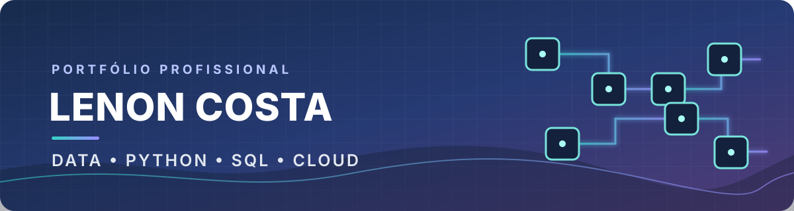

# LENON COSTA

### DADOS • PYTHON • SQL • MICROSOFT AZURE

**Profissional de Tecnologia da Informação direcionando sua carreira para Dados e Engenharia de Dados.**

Construindo soluções, explorando dados e conectando tecnologia a problemas reais.

  
  
  
  

[PORTFÓLIO](https://github.com/lenoncosta/mdc-repo) · [REPOSITÓRIOS](https://github.com/lenoncosta?tab=repositories)

---

## Sobre mim

Sou profissional de Tecnologia da Informação, com formação em **Banco de Dados** e experiência anterior em infraestrutura, suporte e administração de ambientes de TI.

Atualmente, estou direcionando minha trajetória para o ecossistema de **Dados e Engenharia de Dados**. Tenho estudado Python, SQL e serviços de nuvem, desenvolvendo laboratórios e documentando projetos para consolidar conhecimentos em programação, organização, processamento e disponibilização de informações.

Minha experiência com infraestrutura e cloud complementa essa transição: conheço a importância de ambientes confiáveis, automação, segurança e operação de serviços.

**Objetivo profissional:** oportunidades na área de Dados, com foco em Engenharia de Dados e desenvolvimento contínuo em Python, SQL e cloud.

## Stack técnica

### Dados e programação

  
  
  
  

### Cloud e serviços de dados / IA

  
  
  
  

### Engenharia, automação e ferramentas

  
  
  
  

> **Transparência técnica:** os selos representam ferramentas presentes nos meus estudos, laboratórios ou projetos. Não indicam, por si só, domínio avançado ou experiência profissional em todas elas.

## Projetos em destaque

<table>
  <tr>
    <td width="50%">
      <h3>Azure · Dados e Machine Learning</h3>
      Laboratórios com Azure Machine Learning, Azure AI Search, Blob Storage, análise de sentimentos e OCR.
        
      <a href="https://github.com/lenoncosta/-Trabalhando-com-Machine-Learning-na-Pr-tica-no-Azure-ML">Ver projeto →</a>
    </td>
    <td width="50%">
      <h3>Python · Fundamentos</h3>
      Exercícios organizados sobre lógica, estruturas de dados, coleções e programação orientada a objetos.
        
      <a href="https://github.com/lenoncosta/trilha-python-dio">Ver projeto →</a>
    </td>
  </tr>
  <tr>
    <td width="50%">
      <h3>Docker · APIs</h3>
      Projetos didáticos de conteinerização de uma API Python com FastAPI e de um serviço HTTP em Go.
        
      <a href="https://github.com/lenoncosta/Docker-projectos">Ver projeto →</a>
    </td>
    <td width="50%">
      <h3>Portfólio técnico</h3>
      Página central com apresentação profissional, formação, tecnologias e links dos projetos.
        
      <a href="https://github.com/lenoncosta/mdc-repo">Ver portfólio →</a>
    </td>
  </tr>
</table>

## Formação acadêmica

- **Tecnólogo em Banco de Dados** — UNINOVE, 2022.
- **Técnico em Informática** — SENAC, 2018.

## Certificações Microsoft

  
  
  

- Microsoft Certified: Azure Fundamentals (AZ-900).
- Microsoft Certified: Azure Data Fundamentals (DP-900).
- Microsoft Certified: Security, Compliance, and Identity Fundamentals (SC-900).

## Próximos passos de desenvolvimento

Estou aprofundando minha base técnica para evoluir em:

- Construção de pipelines de ingestão e transformação de dados (ETL/ELT).
- Python aplicado a processamento e qualidade de dados.
- SQL, modelagem e consultas em bancos de dados.
- Arquiteturas de dados em cloud.
- Boas práticas de versionamento, documentação e automação.

## Contato

- GitHub: [@lenoncosta](https://github.com/lenoncosta)
- Localização: Canoas, Rio Grande do Sul, Brasil.

---

**Aprendizado contínuo. Projetos práticos. Evolução em Dados.**

